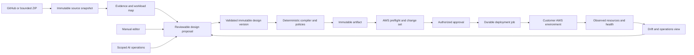

# Implementation contracts

Version 1.0, 14 October 2026. These are target contracts, not claims that these
tables/endpoints already exist. Existing behavior is in RESEARCH_AND_BASELINE.md.
Change a contract only through a recorded decision with migration/test impact.

## 1. Authority and boundaries



The control plane stores desired intent, evidence, approvals and observed state
separately. Observations never silently overwrite desired state. Layout never
changes network configuration. A drawn edge never implicitly grants IAM/SG access.
Each externally visible status names its origin, timestamp, revision and coverage.

## 2. Canonical design v2

Keep current IDs when migrating. Use strict Pydantic models and generated or
contract-tested TypeScript types. No arbitrary executable JSON/YAML, template
macros, shell commands or unknown configuration fields in deployment resources.

| Field | Meaning / constraints |
| --- | --- |
| format / schema_version | `launchcomply-design` / `2`; future major versions are view/export-only until reader support exists |
| design_id / revision_id / parent_revision_id | Server-generated immutable version identity; parent enables comparisons and restore-as-new-version |
| organization_id / application_id | Server-owned tenancy; body values cannot choose another tenant |
| environment_id | FK to the business asset environment; legacy designs may remain explicitly unassigned for planning |
| source_snapshot_ids | Immutable snapshots used for this proposal; current source epoch is separate |
| resources_by_id | Stable existing node ID -> resource or explicit planning-only component |
| workloads_by_id | Logical frontend/BFF/API/worker/job with source evidence and execution mode; maps to zero or more resource IDs |
| connections_by_id | Stable edge ID -> typed purpose/endpoints/protocol/auth/evidence, not an array-index patch target |
| requirements | Traffic, region, availability, budget, recovery, workload policies and declared unknowns |
| view_state | Node positions, collapsed groups, pinned positions, edge bends, zoom/preferences; contains no cloud authority |
| extensions | Explicit versioned non-executable metadata namespaces; unknown extensions preserved but never compiled |

Resource record: `id`, `label`, `catalog_type`, `configuration_schema_version`,
`configuration` (existing resource-specific model), `ownership`, `target`,
`evidence_refs`, `capabilities`. `catalog_type` is a verified CFN type for supported
resources; legacy service text is retained separately as a display label.
Ownership is PLANNED, DISCOVERED_UNMANAGED, IMPORT_PENDING or STACK_MANAGED.
STACK_MANAGED requires observed stack ID/logical ID evidence, not a UI toggle.
Target contains connection/account reference, region and environment. Account ID
may be unknown while planning but must resolve and be verified before planning AWS
changes. Global resources explicitly record scope and controlling region.

Containment comes from typed references such as `vpc_node_id` and
`subnet_node_ids`. Do not create a second editable parent field that disagrees
with those properties. Region/account groups are projections. ALBs and ECS
services span several subnets; render one canonical resource with attachment
badges or visual projections, never duplicate deployed resources to draw each AZ.
Global CloudFront and regional S3 are outside subnet ownership.

Connection purposes: REQUEST, DATA, EVENT, TELEMETRY, BUILD, CONFIG_REFERENCE,
SECURITY_RULE, IAM_PERMISSION. CONFIG_REFERENCE/SECURITY_RULE projections come
from typed settings; editing them opens those settings. A REQUEST connection
records caller mode BROWSER/SERVER/WORKER/UNKNOWN, protocol, destination port,
TLS mode, authentication contract and evidence status. `UNKNOWN` is a real
value, never an inferred secure default. Telemetry/build links are hidden from
the default request-flow view but remain accessible and exportable.

Containment must be acyclic. Request/event/security relationships may contain
cycles. Compiler dependency cycles are evaluated separately and reported with
the resources and fields responsible.

### Migration and identity rules

1. Introduce a pure v1->v2 reader/adapter before switching writers. Preserve all
   node IDs, labels, positions, edge order/multiplicity, configured resources,
   evidence, requirements and unknown legacy metadata.
2. Derive legacy edge IDs deterministically from the source revision ID and
   original edge index; duplicate identical edges remain distinct. After an
   explicit migration save, new edges get IDs once and retain them.
3. Keep original historical payload bytes/JSON archived. Do not bulk rewrite
   history, reassign CloudFormation logical IDs or reset current customer designs.
4. New writes create v2 revisions under a feature flag after round-trip tests.
   Unsupported old clients receive an actionable conflict/upgrade response rather
   than dropping new fields. Ship backend reader support before frontend writers.
5. Maintain a v1 view adapter while replacing UI consumers. Resource properties
   have one canonical owner; do not write independent competing copies.
6. Existing deterministic CloudFormation logical-ID mapping is frozen through
   migration. A label/layout/source-path change must not replace an AWS resource.
7. Restore creates a new head from an old snapshot, records restored_from, and
   re-evaluates freshness/approvals. It does not rewind a deployed stack.

Semantic fingerprint covers resources, connections, workload mapping,
requirements, source snapshots and target. Layout fingerprint is separate.
Layout-only edits do not invalidate an identical deployment artifact. Changes to
images, secrets references, policy/compiler versions or target do invalidate it.
Raw secret values never enter either hash, logs or model context.

## 3. Persistence and concurrency

Reuse `Architecture` in `apps/api/app/models/entities.py` as immutable version
storage initially. Audit every `spec_json` writer, including chat, references,
pending proposals and approvals; moving only source invalidation is insufficient.
Freeze historical embedded metadata and expose new mutable state separately.
Add an
`ArchitectureWorkspaceState` table keyed by `(organization_id, application_id,
environment_id)` for head revision, source epoch, active proposal, analysis/AI
job pointers and optimistic state version. Put conversations/proposals/approval
events in separately scoped records rather than mutating design snapshots.
Migrations must account for currently nullable/unassigned environment.
Do not rely on ordinary nullable UNIQUE semantics for the unassigned workspace:
use an explicit default environment or appropriate separate partial uniqueness
constraints, with concurrent-initialize tests. Never hold a workspace database
lock across a slow GitHub/model/AWS request: capture version/epoch, do bounded
external work, then reacquire and compare before publishing a proposal.

Proposed additional records (reuse an existing suitable table after field audit;
do not create a duplicate business object):

| Record | Required identity / integrity |
| --- | --- |
| SourceSnapshot | org/app/link ID, effective branch/root, commit SHA or upload hash, parser version, coverage, evidence digest, creation time; immutable |
| DesignProposal | org/app/env, base revision/hash, source epoch, author/job, operation list, exact diff, expiry, status |
| DesignApproval | actor, role/policy version, artifact/plan hash, account/region/env, approved_at/expires_at; append-only decisions/revocations |
| DeploymentArtifact | design revision, compiler/policy versions, template bytes/hash, parameters, source/image digests, exclusions and manifest |
| DeploymentPlan | artifact ID/hash, target identity, change-set ARN/type, resource changes, risk/expiry/preflight evidence |
| DeploymentRun | org/app/env, plan ID, idempotency key, state, lease/fencing token, AWS client token/operation IDs, timestamps |
| Job / OutboxEvent | tenant, kind, payload reference, attempt/next_at, lease owner/expiry, cancellation and deduplication key |
| ResourceObservation | target/stack/logical/physical IDs, observed properties digest, time, scope, status and coverage |
| CapabilityEvidence | resource type + schema/compiler version + region + acceptance level + evidence reference/time |

All data reads and writes are tenant-scoped in the query. Composite FKs/unique
constraints prevent cross-tenant references. Lock the workspace/environment row
for head transitions; use expected revision and state version, and DB uniqueness
for at most one active deployment per target. SQLite tests do not validate
PostgreSQL locking behavior. Tenant context must also bind background jobs,
downloads, artifact storage paths, webhooks and retries.

Repository removal/revocation increments the current source epoch and revokes
current eligibility. It never edits past snapshots. Approval validity is computed
from current authority + hashes + revocation events; a past approval remains an
auditable event but cannot authorize a stale run. Recheck membership, target
connection and artifact at execution time, not only when a button is rendered.

## 4. Source-to-design contract

Effective source identity = GitHub installation + repository ID + selected ref
+ normalized root + resolved commit SHA. Fetch by provider ID and pinned SHA.
Validate root traversal/symlinks, prevent redirects/SSRF, bound bytes/files/time,
rate-limit per business and never execute repository scripts during inspection.
Installation revocation, partial reads and truncated trees produce explicit
partial/error results. Existing snapshots remain available with their provenance.

Evidence item includes ID, repository/link/snapshot ID, path, line range when
available, blob hash, extractor/version, fact kind, confidence and limitations.
Preserve facts only; exclude environment values, private keys and raw source from
persisted evidence and external model context by default. For unsupported runtime
parsers, report UNKNOWN/PARTIAL and offer manual mapping. Do not call an SDK
dependency a confirmed network connection.

Workload identity is persisted by source link + root + stable service manifest
identity, with rename/merge suggestions reviewed. Source refresh creates a new
snapshot and a reconciliation proposal: added/changed/missing workloads and
links, conflicts, retained manual resources/settings/layout. Deletions are never
automatically applied. If nothing semantic changed, retain the head and return a
no-change analysis receipt. An analysis failure leaves current design unchanged.

Environment mapping UI accepts **variable names and destination references**.
Secrets are separate references to customer Secrets Manager/SSM or a future
audited encrypted secret service; raw `.env` values must not be saved in diagrams,
shared exports or sent to an LLM. URLs are parsed/redacted with source/client
execution mode, not fetched. `DATABASE_URL` with credentials becomes a typed
secret reference plus connection intent, never a logged URL.

## 5. API behavior

Keep current `/api/v1/architecture/workspace/{application_id}` compatibility;
extend subresources rather than creating a competing architecture API.

| Operation | Target contract |
| --- | --- |
| GET workspace/history/version | Tenant-scoped immutable snapshot + current eligibility projection; bounded history pagination |
| PUT repository links | Link ID/repository/ref/root + expected links version; validates access; increments source epoch |
| POST analyze | Expected head/source epoch + idempotency key -> 202 analysis job; no destructive rebuild |
| GET analysis/{id} | Progress/coverage/evidence/proposal/error; cancellation and retry are explicit |
| POST proposals | Typed operations + base revision/hash + scope; server validates whole candidate |
| POST proposals/{id}/apply | Rechecks exact base, authority, source epoch and expiry; atomic new revision |
| POST restore | Expected head + old revision ID -> new revision with stale approval cleared |
| POST compile | Expected revision + supported full/subset choice -> exact immutable artifact and omissions |
| POST plans | Artifact ID + target + idempotency key -> AWS preflight/change-set job |
| POST plans/{id}/approve | Exact plan/artifact hash, capability acknowledgement, authorized actor and expiry |
| POST plans/{id}/execute | Valid approval + idempotency key -> durable run; never called by AI |
| GET runs/events/observations | Persisted state, provider event IDs, last observed time; cursor polling/SSE reconnect |

Errors include stable code, safe message, field/node references, retryable flag and
correlation ID. 409 stale conflicts retain the local draft with reload/diff action;
422 validation highlights the field; 403 explains required role without leaking
other tenants; 429 includes a bounded retry hint; 503 shows provider unavailable.
Never convert a provider outage into success, zero cost or an invalid-login verdict.

## 6. AI contract

Keep LangGraph/LangChain. Stages: resolve intent/selected IDs -> gather bounded
source/network context -> clarify ambiguity -> propose typed operations ->
deterministic validation -> persist exact review candidate. Model output is data.
The model cannot select its own tenant, scope, provider spending policy or tools.

Allowed operations initially: update selected display fields, update selected
supported properties, add explicitly requested resources with typed config,
connect/disconnect typed edges, remove selected resources with dependency review.
Each operation includes stable ID, allowed field path and optional before-value.
No replacing the graph root, moving unrelated nodes, regenerating IDs, changing
unselected resources, silently changing account or removing unrelated edges.
Revalidate the entire candidate after scope checks. Unknown answers ask at most
three concrete questions with options and a free-text path.

Routing has configurable verified model IDs, provider capability metadata,
per-request token/time/attempt limits, jittered retry, circuit breaker and tenant
quota. A maximum of two repair attempts is a target bound, not permission for an
unlimited fallback loop. Free-only mode enforces zero-priced eligible routes and
ends with a verified free router only if available. It fails clearly if none
succeed. Paid fallback requires an explicit configured budget and user opt-in.
No hardcoded assumption that old `:free` names remain available. Provider/model,
latency, attempts and bounded usage are observable without logging prompts/secrets.

Evaluation corpus must include source refresh, graph cycles, duplicate labels,
multi-repo frontends, BROWSER calls to private API, changed branch, malicious
repository instructions, secret canaries, stale versions, schema failures,
rate limits, timeout after a response and selected-node property preservation.
Provider mocks prove routing behavior; separately labelled live evaluations prove
model quality. Human Apply remains mandatory for architecture mutation.

## 7. Compiler and service support

Resource registry owns schema, UI field metadata, validation, reference resolver,
compiler, region constraints, documentation URL, drift/import support and test
fixtures. Client support badges are generated from that registry/evidence.
The broad catalog remains searchable; unsupported deployment properties cannot
escape through a raw JSON editor.

First complete workload family: VPC/network/SG foundation -> ALB/HTTPS listener/
listener rule/target group -> ECS cluster/task/service -> constrained task and
execution IAM roles + image/secret refs -> database subnet group/RDS PostgreSQL
and optional Aurora profile -> scaling/alarms -> S3/endpoint -> DNS/ACM/WAF/CDN.
Implement each family end-to-end: edit -> validation -> diff/history -> compile
-> policy tests -> supported badge. No badge ahead of its evidence.

Compiler input is one immutable design. Output includes exact template, logical-ID
map, target, parameters/secret refs, image digests, manifest, omission report,
compiler/policy versions and checksum. Full deployment blocks on missing required
resources. An explicit subset export is not an executable full-application plan.
Retain/snapshot policies and replacements require visible review. No template
macros/custom resources/unbounded IAM wildcards in the first deployment profile.

## 8. Deployment and recovery state machine

```text
QUEUED -> PREFLIGHT -> CHANGESET_CREATING -> AWAITING_REVIEW
AWAITING_REVIEW -> APPROVED -> EXECUTION_REQUESTED -> EXECUTING
EXECUTING -> VERIFYING -> SUCCEEDED
EXECUTING/VERIFYING -> ROLLING_BACK -> ROLLED_BACK | MANUAL_RECOVERY
any pre-execution stage -> FAILED | CANCELLED | EXPIRED | SUPERSEDED
ambiguous provider response -> RECONCILING (not an automatic second execution)
```

Persist provider event IDs before acknowledging progress. Claim jobs with DB
leases/fencing; use a stable AWS client request token where supported. Delivery
is at-least-once: on timeout/restart query AWS state and reconcile rather than
claiming exactly-once execution. A duplicate execute request returns the same run.
Kill/restart tests must cover the gap between AWS acceptance and local commit.

Preflight verifies actual account/region/role, artifact integrity, quotas,
supported resource types, certificate/secret/image existence and target ownership.
Do not equate ValidateTemplate with deployability. Change-set review includes
create/update/delete/replacement, IAM capabilities, retained resources, costs and
policy exceptions. Approvals expire or are superseded on any bound input change.

Execution requires explicit supported target/budget authorization. Automated
release health uses a predeclared allowlisted endpoint/probe running in the right
network, ECS/ALB/AWS events and timeout bounds. Generic user URLs are not fetched
by an unrestricted control-plane probe. Database migrations are separate reviewed
jobs with expand/contract strategy; infrastructure rollback is not data rollback.

Cancel means stop/reconcile where the provider permits it, not delete everything.
No blanket cleanup of customer accounts. Tag and inventory owned sandbox resources;
retained data and manual recovery are displayed and handed to an operator.

## 9. Editor and operational presentation

Extract domain selectors, command/history reducer, viewport/layout and transport
from the large ArchitectureCanvas component before replacing the renderer.
Evaluate React Flow plus ELK worker against the current SVG using identical
fixtures and interactions. Adopt only if migration, licensing, keyboard, export,
bundle and performance gates pass; otherwise improve the current renderer.

Manual minimum: multi-select, duplicate with new IDs and reviewed dependencies,
copy/paste safe subset, align/distribute, group collapse, search/minimap, port-aware
connections, keyboard delete/undo/redo, pinned layout and selected-area arrange.
One drag is one undo transaction. Typing in fields does not trigger canvas shortcuts.
Cancel/restore/resize retains unsaved form values. Group dragging changes layout,
never network ownership; membership changes are explicit field edits and reviews.

Default view shows numbered request flow and primary workload nodes; expand
infrastructure detail on demand. Unresolved placement is visible. Keep monitoring,
build and security policy associations in selectable overlays. At readable zoom,
component names must be legible; fitting hundreds of resources into the viewport
is not a readability solution. Persist a stable design/view selection across saves.

Observed health/cost/drift use timestamp, provider request/evidence, scope and
freshness. Unknown is distinct from healthy, zero and compliant. Readiness is
framework/scope/version-specific verified controls divided by applicable required
controls, with pending/failed/unknown/not-applicable counts and reviewed exclusions.
100% internal checklist completion permits a review request, not certification.

## 10. Customer SaaS tenancy and security decisions

Platform tenant isolation and the customer's own SaaS tenant isolation are two
different responsibilities. LaunchComply can verify its own authorization and
inspect/configure supported customer controls; it cannot infer that a deployed
application isolates tenant data merely from private subnets or an authentication
library dependency. Record the customer's tenancy strategy as shared/pool,
dedicated/silo, hybrid or unknown, with evidence and unresolved decisions.

For each supported SaaS blueprint specify identity provider/issuer/audience,
where tenant identity is derived and validated, API authorization, database
ownership/query enforcement, tenant-aware cache/object keys, worker context and
rate/concurrency budgets. Never trust a caller-supplied tenant ID without binding
it to authenticated authority. Tenant-scoped integration tests belong to the
customer acceptance fixture, separately from LaunchComply's T01-T05 tests.

Security groups, TLS, WAF and private routing are independent controls; none
substitutes for application authorization. If the repository does not implement
required BFF, authentication or tenant enforcement, the design must expose that
application change as a deployment blocker with an actionable implementation
contract. Do not silently generate or claim such runtime behavior from an icon.

Budget, region/data residency, backup/restore, encryption key ownership, secret
rotation and support responsibilities are declared design decisions. Offer
supported defaults with rationale and cost, preserve explicit customer choices,
and require a reviewed exception where policy allows it. Multi-VPC/account
connectivity is explicit infrastructure with routing/DNS/identity requirements,
not a replacement label for public and private subnets.
